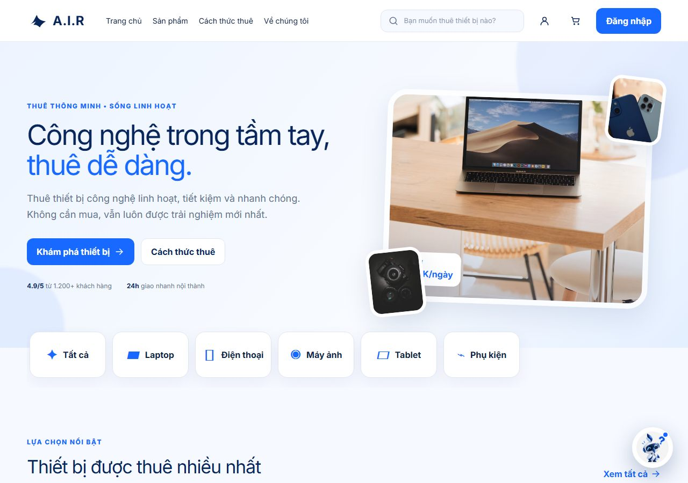

# A.I.R — Thuê thiết bị công nghệ


Website thuê laptop, điện thoại, máy ảnh, tablet và phụ kiện công nghệ theo ngày:
chọn thiết bị → chọn thời gian thuê → điền thông tin nhận máy → theo dõi đơn.

Đây là bản **source chạy được và chỉnh sửa được**. Giao diện (CSS, bố cục, mascot, breakpoint)
giữ nguyên bản gốc; phần logic được viết lại bằng React và đã sửa các lỗi của bản publish.

> **Trạng thái:** demo front-end. Không có backend, không có thanh toán thật,
> dữ liệu nằm trong `localStorage` của trình duyệt.

## Mục lục

- [Chạy nhanh](#chạy-nhanh)
- [Bản Next.js (GĐ 0)](#bản-nextjs-gđ-0)
- [Lệnh](#lệnh)
- [Công nghệ](#công-nghệ)
- [Cấu trúc](#cấu-trúc)
- [Màn hình](#màn-hình)
- [Dữ liệu & lưu trữ](#dữ-liệu--lưu-trữ)
- [Khác bản gốc](#khác-bản-gốc)
- [Giới hạn đã biết](#giới-hạn-đã-biết)
- [Lộ trình](#lộ-trình)
- [Ghi công & giấy phép](#ghi-công--giấy-phép)

## Chạy nhanh

Yêu cầu **Node 18+** (đã test với Node 24) và npm.

```bash
npm install
npm run dev
```

Mở http://localhost:5173. Bản build tĩnh:

```bash
npm run build     # ra dist/
npm run preview   # xem thử bản build
```

## Bản Next.js (GĐ 0)

Repo đang có **hai app chạy song song**. Bản Vite giữ nguyên để đối chiếu giao diện; bản
Next.js là đích của giai đoạn 0 và sẽ thay bản Vite khi sang giai đoạn 1.



|            | Bản Vite (thư mục gốc)  | Bản Next.js (`web/`)                         |
| ---------- | ----------------------- | -------------------------------------------- |
| Công nghệ  | React 19 + Vite 7 + JSX | Next.js 15 + React 19 + TypeScript strict    |
| Điểm vào   | `index.html` → `src/`   | `web/src/app/`                               |
| Cổng dev   | 5173                    | 3000                                         |
| Điều hướng | state `view`            | state `view` (giống hệt, chưa có URL)        |
| Style      | `src/styles/site.css`   | `web/src/app/globals.css` (bản sao y nguyên) |

```bash
cd web
npm install
npm run dev                  # http://localhost:3000
npm run build && npm start   # bản production, cũng cổng 3000
```

| Lệnh trong `web/`      | Việc                                     |
| ---------------------- | ---------------------------------------- |
| `npm run dev`          | Dev server Next.js                       |
| `npm run build`        | Build production (`.next/`)              |
| `npm start`            | Chạy bản build                           |
| `npm run lint`         | ESLint 9 (flat config, `jsx-a11y`, Next) |
| `npm run typecheck`    | `tsc --noEmit`                           |
| `npm run format`       | Prettier ghi đè                          |
| `npm run format:check` | Chỉ kiểm tra định dạng                   |

### Cấu trúc `web/`

```
web/
  src/
    app/                    # App Router
      layout.tsx            # <html lang="vi">, metadata, favicon
      page.tsx              # render ClientApp
      client-app.tsx        # dynamic(ssr: false) — GĐ 0 chạy hoàn toàn client-side
      globals.css           # bản sao y nguyên site.css
    components/
      app-shell.tsx         # state toàn cục + điều hướng 8 màn
      layout/               # Header, Footer, BottomNav, ChatLauncher
      ui/                   # Icons, Mascot, ProductCard, Toast
      chat/                 # ChatWidget + chat-engine
    views/                  # 8 màn: HomeView … AccountView
    features/               # schema Zod + domain, dựng sẵn cho GĐ 1–2
    lib/                    # format, dates, pricing, order-code, storage, env, observability
    data/products.ts        # danh mục + 6 sản phẩm
    types/index.ts          # type dùng chung
  .env.example              # biến môi trường (Supabase, Sentry)
  eslint.config.js          # flat config ESLint 9
```

Điểm kỹ thuật đáng lưu ý:

- **CSS sao y nguyên** — `globals.css` trùng SHA-256 với `src/styles/site.css`, nên breakpoint
  900/560px và mọi chi tiết giao diện không đổi.
- **Chạy client-side** — app đọc `localStorage` ngay lần render đầu, nên `client-app.tsx` dùng
  `dynamic(..., { ssr: false })` để tránh lệch hydration. GĐ 1 mới tách server component + URL.
- **TypeScript strict** — bật `strict`, `noUnusedLocals`, `noUnusedParameters`; alias `@/*` → `web/src/*`.
- **Env có schema** — `lib/env.ts` validate bằng Zod; thiếu biến thì báo lỗi rõ ràng thay vì `undefined`.
- **Sentry** — `lib/observability.ts` gửi lỗi production khi có `NEXT_PUBLIC_SENTRY_DSN`.
- **CI** — `.github/workflows/ci.yml`: `npm ci` → lint → typecheck → build trên mỗi push/PR.

### Trạng thái GĐ 0

- [x] Next.js 15 + TypeScript strict, port đủ 8 màn và `site.css`
- [x] ESLint 9 + Prettier + `tsc --noEmit`
- [x] Env schema (Zod), Sentry hook, cấu trúc `features/`
- [x] CI lint + typecheck + build
- [x] Kiểm chứng giao diện khớp bản Vite (số liệu bên dưới)
- [x] **Husky + lint-staged**: `.husky/pre-commit` chạy `cd web && npx lint-staged` (chỉ kiểm tra
      app Next trong `web/`). Repo đã `git init` nhánh `main`; `prepare: cd .. && husky .husky`
      đã tạo `.husky/_` ở gốc và trỏ `core.hooksPath` vào đó — hook chạy thật khi commit.
- [~] **Deploy preview**: bỏ qua theo quyết định — GĐ 0 nghiệm thu bằng build production
  chạy local (`npm run build && npm start`) thay vì deploy.

Kiểm chứng parity (cùng cửa sổ 1000×700, `localStorage` rỗng):

- Chạy 13 bước — trang chủ → anchor → danh mục → chi tiết → tăng số lượng → giỏ → checkout →
  validate → đặt đơn → đơn thuê → mở chat → chat trả lời → đăng nhập — trên cả hai bản:
  **0 khác biệt** về nội dung, số tiền, class, computed style và thứ tự DOM
  (bỏ qua mã đơn, ngày và nội dung toast vốn ngẫu nhiên/theo thời điểm).
- Ảnh chụp headless: bản dev lệch **0,29%** (479px) và **0,06%** (1280px) số pixel; bản build
  production lệch **0,40%** và **0,06%**. Mức nhiễu khi chụp **cùng một app hai lần** là
  0,25–0,41% (mascot FAB có animation vô hạn), tức khác biệt giữa hai bản nằm trong ngưỡng nhiễu.
- `lint`, `typecheck`, `format:check` sạch; `next build` OK — 104 kB First Load JS.

## Lệnh

| Lệnh                   | Việc                                 |
| ---------------------- | ------------------------------------ |
| `npm run dev`          | Dev server có hot reload             |
| `npm run build`        | Build production vào `dist/`         |
| `npm run preview`      | Chạy thử bản build                   |
| `npm run lint`         | ESLint: lỗi code + quy ước           |
| `npm run lint:fix`     | ESLint tự sửa phần sửa được          |
| `npm run format`       | Prettier định dạng lại toàn bộ       |
| `npm run format:check` | Chỉ kiểm tra định dạng (dùng cho CI) |

## Công nghệ

| Lớp        | Chọn                                   | Ghi chú                                                |
| ---------- | -------------------------------------- | ------------------------------------------------------ |
| UI         | React 19                               | JSX thuần, chưa dùng TypeScript                        |
| Build      | Vite 7                                 | HMR, build ~1.3s                                       |
| Style      | CSS thuần (1 file)                     | Output gốc của Figma Make, không dùng Tailwind runtime |
| State      | `useState` / `useMemo` trong `App.jsx` | Chưa cần thư viện state                                |
| Lưu trữ    | `localStorage`                         | Giỏ, đơn, yêu thích, phiên đăng nhập demo              |
| Điều hướng | State `view`                           | Không có URL riêng                                     |
| Icon       | SVG component tự viết                  | Không phụ thuộc thư viện icon                          |
| Chất lượng | ESLint 9 + Prettier 3                  | Flat config, có `jsx-a11y`                             |

Không có backend, không có API. Mọi thao tác chạy trong trình duyệt.

## Cấu trúc

```
src/
  app/
    main.jsx                 # điểm vào, mount React
    App.jsx                  # state toàn cục + điều hướng giữa các màn
  pages/                     # mỗi màn hình một file, hậu tố "Page"
    HomePage.jsx
    ProductsPage.jsx
    ProductDetailPage.jsx
    CartPage.jsx
    CheckoutPage.jsx
    CheckoutSuccessPage.jsx
    OrdersPage.jsx
    AccountPage.jsx
  components/
    layout/                  # khung trang
      Header.jsx
      Footer.jsx
      BottomNav.jsx          # thanh điều hướng mobile
      ChatLauncher.jsx       # nút mascot nổi
    ui/                      # thành phần dùng lại
      Icons.jsx
      Mascot.jsx
      ProductCard.jsx
      Toast.jsx
    chat/
      ChatWidget.jsx         # giao diện hộp thoại
      chat-engine.js         # logic trả lời (rule-based)
  data/
    products.js              # danh mục + 6 sản phẩm  ← sửa giá/tên/ảnh tại đây
  lib/
    format.js                # money(), dateVN(), nowTime()
    dates.js                 # toISO, addDays, daysBetween, todayISO
    pricing.js               # lineTotal(), cartSubtotal()
    order-code.js            # sinh mã đơn AIR-XXXXXX
    storage.js               # đọc/ghi localStorage
  styles/
    site.css                 # CSS gốc của Figma Make
```

Thư mục khác:

| Đường dẫn         | Mô tả                                                                                      |
| ----------------- | ------------------------------------------------------------------------------------------ |
| `web/`            | Bản Next.js 15 + TypeScript (GĐ 0) — xem mục [Bản Next.js](#bản-nextjs-gđ-0)               |
| `docs/ROADMAP.md` | Kiến trúc đích, mô hình dữ liệu, 8 giai đoạn phát triển                                    |
| `original-build/` | Bản build gốc tải từ Figma (JS đã minify, **không sửa được**) — giữ để đối chiếu giao diện |
| `public/`         | Mascot và favicon                                                                          |

### Quy ước đặt tên

| Loại            | Quy ước                    | Ví dụ                             |
| --------------- | -------------------------- | --------------------------------- |
| Thư mục         | kebab-case, số nhiều       | `components/`, `pages/`           |
| React component | PascalCase, trùng tên file | `ProductCard.jsx` → `ProductCard` |
| Trang           | PascalCase + hậu tố `Page` | `CartPage.jsx` → `CartPage`       |
| Module thường   | kebab-case                 | `chat-engine.js`, `order-code.js` |

Định dạng do Prettier quyết định: không dấu `;`, nháy đơn, rộng 100 cột, 2 space, LF.
ESLint lo phần đúng/sai: `react-hooks`, `jsx-a11y`, `prefer-const`, `eqeqeq`, `no-console`.

## Màn hình

| Màn          | File                      | Nội dung                                                                      |
| ------------ | ------------------------- | ----------------------------------------------------------------------------- |
| Trang chủ    | `HomePage.jsx`            | Hero, danh mục, 4 thiết bị nổi bật, lợi ích, 3 bước thuê, CTA chat            |
| Danh mục     | `ProductsPage.jsx`        | Lọc theo danh mục, sắp xếp theo giá, tìm kiếm, trạng thái rỗng                |
| Chi tiết     | `ProductDetailPage.jsx`   | Thông số, chọn số ngày (1/3/7/14) và số lượng, tạm tính, thêm giỏ / thuê ngay |
| Giỏ thuê     | `CartPage.jsx`            | Tăng giảm số lượng, xóa món, tóm tắt tiền                                     |
| Đặt thuê     | `CheckoutPage.jsx`        | Khoảng ngày, hình thức nhận, thông tin người thuê, validate                   |
| Xác nhận     | `CheckoutSuccessPage.jsx` | Mã đơn, thời gian, tổng tiền                                                  |
| Đơn thuê     | `OrdersPage.jsx`          | Danh sách đơn đã đặt (lưu qua reload)                                         |
| Tài khoản    | `AccountPage.jsx`         | Đăng nhập demo bằng SĐT/email, đăng xuất                                      |
| Trợ lý A.I.R | `ChatWidget.jsx`          | Chat trả lời theo quy tắc + gợi ý sản phẩm, nút điều hướng                    |

Luồng chính: **Trang chủ → Danh mục → Chi tiết → Giỏ → Đặt thuê → Xác nhận → Đơn thuê**.

## Dữ liệu & lưu trữ

Sản phẩm nằm trong `src/data/products.js` (6 mẫu, ảnh lấy từ Unsplash).
Mọi state phía người dùng được lưu vào `localStorage` để reload không mất:

| Key             | Nội dung                              |
| --------------- | ------------------------------------- |
| `air-cart`      | Giỏ thuê: sản phẩm, số ngày, số lượng |
| `air-orders`    | Danh sách đơn đã đặt                  |
| `air-favorites` | ID thiết bị yêu thích                 |
| `air-user`      | Phiên đăng nhập demo                  |

Xóa toàn bộ: `localStorage.clear()` trong DevTools.

## Khác bản gốc

Bản publish của Figma có vài lỗi logic. Bản này sửa:

1. **Giỏ và checkout khớp tiền** — ngày kết thúc được khởi tạo theo số ngày trong giỏ
   (bản gốc: giỏ 3 ngày = 1.050.000 ₫ nhưng checkout tự tính 2 ngày = 750.000 ₫).
2. **Đơn thuê được lưu** — reload không mất.
3. **Xóa được món trong giỏ**, giỏ tự clear sau khi đặt.
4. **Đăng nhập demo có tác dụng** — lưu phiên, vào được trang tài khoản.
5. **Yêu thích được lưu**, có `aria-pressed`.
6. **Tìm kiếm ở header hoạt động toàn cục** — Enter là sang trang danh mục kèm từ khóa.
7. **"Cách thức thuê" / "Về chúng tôi"** cuộn tới đúng section.
8. **Validate ngày** — ngày kết thúc không thể trước ngày bắt đầu.
9. **Tiêu đề trang, `lang="vi"`, favicon thương hiệu** (bản gốc: "Figma Make App", `lang="en"`).
10. **Bàn phím** — thẻ sản phẩm mở được bằng Enter/Space, không chỉ chuột.
11. Thêm `inputMode`, `autocomplete`, `aria-label` cho form và nút icon.

Giữ nguyên có chủ ý: toàn bộ nội dung, bố cục, hiệu ứng, breakpoint 900/560px, mascot —
kể cả câu **"Chỉ từ 350K/ngày"** dù thiết bị rẻ nhất là 90K/ngày.
Sửa ở `src/pages/HomePage.jsx` nếu muốn đổi.

## Giới hạn đã biết

- **Không có backend.** Đơn thuê chỉ nằm trên máy người đặt, không có ai xác nhận.
  Tồn kho là số cố định (`available`), không chặn trùng lịch theo ngày.
- **Không có URL riêng cho từng màn** — không share/deep-link được, SEO kém. Bản Next.js cũng
  giữ nguyên hạn chế này ở GĐ 0; URL routing nằm trong GĐ 1.
- **Ảnh hotlink Unsplash** — phụ thuộc mạng ngoài, cần thay bằng ảnh thật.
- **Tương phản chưa đạt AA** ở vài nhãn nhỏ: badge "Còn hàng" (2.97),
  bottom-nav 9px (3.55), timestamp chat 8px (2.81).
- **Chat là rule-based**, không gọi API/LLM.
- Bundle bản Vite: 262 kB JS (81 kB gzip) + 29,5 kB CSS (7,3 kB gzip).
  Bản Next: 104 kB First Load JS.
- **Bản Next chưa có URL riêng/deploy** — chạy local ở cổng 3000; deploy bỏ qua ở GĐ 0.

## Lộ trình

Xem [`docs/ROADMAP.md`](docs/ROADMAP.md): công nghệ đích (Next.js + Supabase), cấu trúc feature-based,
mô hình dữ liệu chống trùng lịch, 8 giai đoạn triển khai, chi phí và rủi ro.

**Đang ở GĐ 0** — app Next.js đã dựng trong `web/`, giao diện khớp bản Vite, build production
chạy được ở local. Deploy preview đã bỏ qua theo quyết định; Husky đã cài và chạy khi commit.
Repo đã `git init` (nhánh `main`), **chưa có remote** — chưa push.

## Ghi công & giấy phép

Giao diện dựa trên **"Electronics Rental Website"** của tác giả **Pam** trên Figma Community,
giấy phép [CC BY 4.0](https://creativecommons.org/licenses/by/4.0/).

Theo CC BY 4.0, bạn được phép sửa và dùng thương mại, với điều kiện **ghi công tác giả**
và **ghi rõ đã chỉnh sửa**. Bản này là tác phẩm phái sinh: giữ CSS và bố cục gốc, viết lại
toàn bộ logic bằng React và sửa các lỗi liệt kê ở trên.

- Ảnh sản phẩm: Unsplash, theo [Unsplash License](https://unsplash.com/license).
- Mascot robot: thuộc bản gốc của tác giả Pam.
- Dòng "Prototype UI/UX phi thương mại" ở footer là nội dung demo của bản gốc, không phải điều khoản giấy phép.
