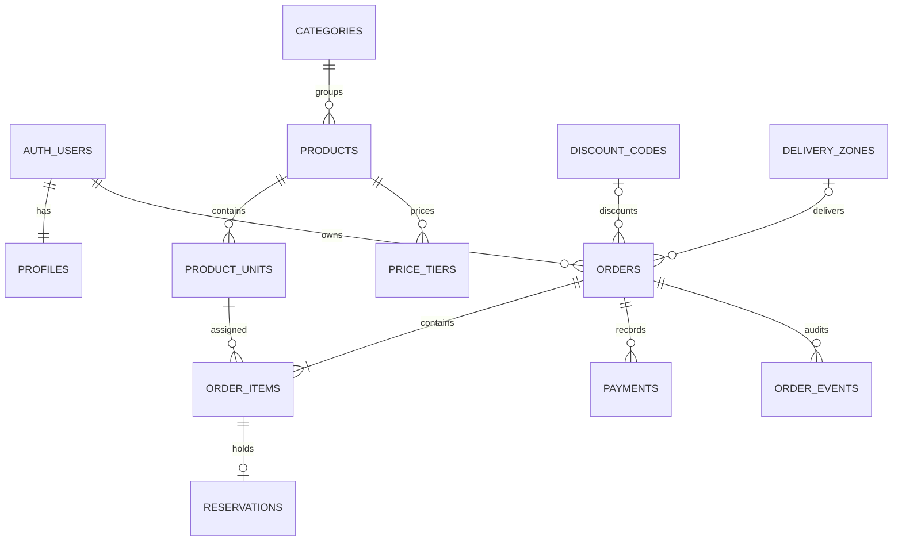
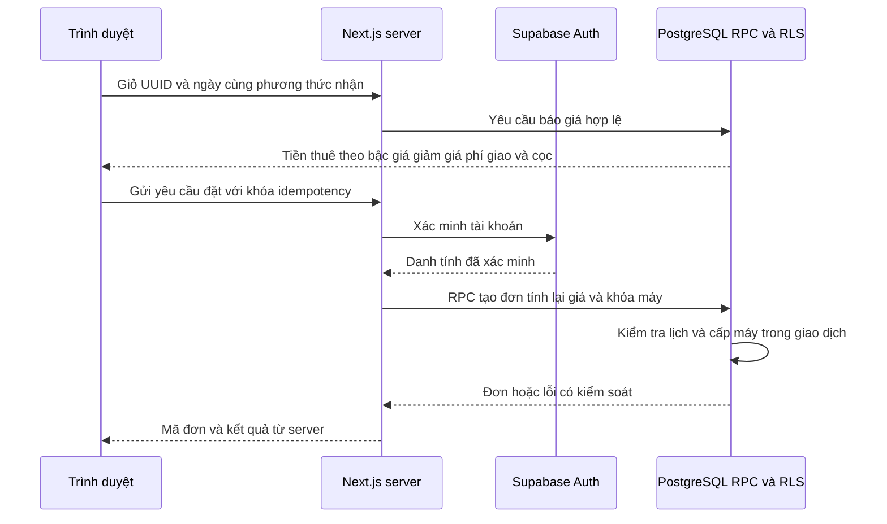
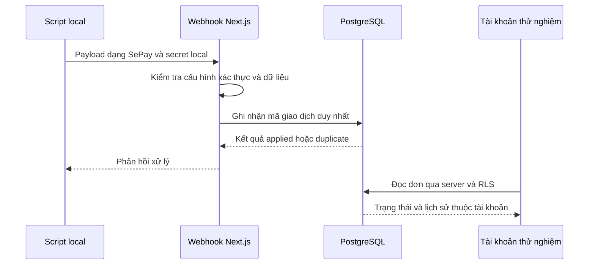

# Kịch bản bảo vệ đồ án A.I.R

Đồ án học tập mô phỏng quản lý thuê thiết bị. Không thu tiền, không giao máy thật, không dùng giấy tờ hoặc tài khoản cá nhân thật.

## Nội dung trình bày trong 15 phút

| Thời gian | Nội dung | Điều cần chứng minh |
|---|---|---|
| 0–2 phút | Bài toán và phạm vi | Thuê theo ngày, máy vật lý, tránh đặt trùng; phân biệt mô phỏng với dịch vụ thật |
| 2–5 phút | Kiến trúc và dữ liệu | Giá/tồn kho do server và DB quyết định, quyền truy cập theo tài khoản |
| 5–10 phút | Demo hành trình chính | Catalog → giỏ → báo giá → tạo đơn → thanh toán giả lập → xem đơn |
| 10–12 phút | Quản trị và tình huống lỗi | Máy đang được giữ không được loại khỏi kho; đơn cũ vẫn tìm được; người khác không đọc được đơn |
| 12–15 phút | Kiểm thử và giới hạn | Bằng chứng tự động, phạm vi local, việc chưa triển khai và hướng mở rộng |

Nếu backend không sẵn sàng, chuyển sang xem video/bằng chứng của phiên bản đã kiểm thử và nói rõ đây là bản ghi. Không đánh dấu một thao tác live là đạt khi chỉ xem ảnh hoặc kết quả cũ.

## Sơ đồ dữ liệu cốt lõi

Sơ đồ lược bỏ bảng địa chỉ/yêu thích/giấy tờ để tập trung vào thuê máy. `order_items` giữ lịch sử và giá snapshot; `reservations` giữ khoảng thời gian chặn tồn kho. Một đơn nhiều máy có nhiều dòng cấp máy. Tiền cọc không nằm trong `total_vnd` của tiền thuê sau giảm và phí giao.

## Sơ đồ trình tự đặt thuê

Báo giá không giữ máy và không bảo đảm giá sẽ không đổi. RPC tạo đơn kiểm tra lại dữ liệu; nếu lỗi hoặc hết máy, không coi thao tác ở giao diện là giao dịch đã hoàn tất. Khi gửi lại cùng yêu cầu, khóa idempotency ngăn tạo đơn trùng; đổi nội dung phải tuân theo cơ chế xác thực request hiện có.

## Sơ đồ thanh toán giả lập

Không có lệnh chuyển tiền tới ngân hàng. Việc ghi nhận hoàn cọc trong bài tập không chứng minh tiền thật đã được chuyển. Không bật provider trả phí để minh họa sơ đồ này.

## Câu hỏi thường gặp khi bảo vệ

**Vì sao không tính giá hoàn toàn ở trình duyệt?** Người dùng có thể sửa request hoặc dữ liệu hiển thị. Server/DB phải tính lại theo dữ liệu có thẩm quyền; giao diện chỉ trình bày báo giá.

**Vì sao cần cả máy vật lý và sản phẩm?** Sản phẩm là model, còn máy vật lý là đơn vị cấp phát có trạng thái và lịch riêng. Hai máy cùng model có thể có thời gian khả dụng khác nhau.

**Vì sao khóa hàng chưa đủ để tránh đặt trùng?** Cần phối hợp khóa hàng với ràng buộc khoảng thời gian và giao dịch atomic. Ràng buộc DB là lớp bảo vệ khi có nhiều request hoặc đường truy cập.

**Tại sao mẫu catalog không đặt được?** Danh sách tham khảo không đại diện tồn kho. Demo checkout dùng fixture local được đánh dấu riêng; không bỏ chặn SAMPLE cho toàn bộ catalog.

**AI có quyết định đơn hoặc giá không?** Không. FAQ có thể chạy theo quy tắc; AI tùy chọn chỉ chọn công cụ giới hạn. Server và database quyết định quyền, giá và tồn kho.

**Đồ án đã sẵn sàng kinh doanh chưa?** Đó không phải mục tiêu nghiệm thu. Các kết quả chứng minh phạm vi local; ngân hàng/SMS/AI thật, dữ liệu khách thật và vận hành công khai cần phạm vi đánh giá riêng.

## Kiểm tra trước buổi trình bày

Mở [hướng dẫn demo](DEMO-GUIDE.md), kiểm tra đúng project local, chuẩn bị fixture và trình duyệt mới. Dùng [phiếu đánh giá](templates/pilot-acceptance.md) để ghi kết quả quan sát. Đối chiếu số test và video với báo cáo nghiệm thu cuối, không dùng số liệu dự kiến làm kết quả đã đạt.
