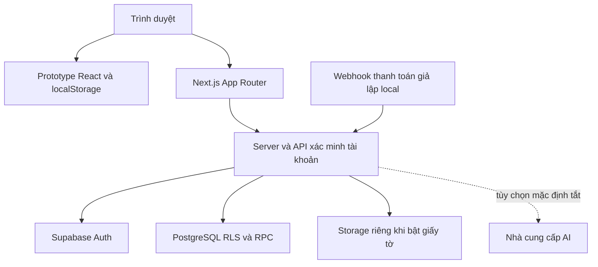

# Báo cáo đồ án A.I.R

Phiên bản 1.0 · 02/11/2026 · Dự án học tập mô phỏng thuê thiết bị công nghệ.

## Tóm tắt

A.I.R xây dựng giao diện tìm thiết bị và luồng đặt thuê theo ngày, kết hợp quản lý tài khoản, tồn kho máy vật lý, thanh toán giả lập và trợ lý hỗ trợ. Mục tiêu là thực hành phát triển ứng dụng web có kiểm soát dữ liệu và kiểm thử. Dự án không cung cấp dịch vụ thuê thật, không thu tiền và không đại diện cho một doanh nghiệp đang hoạt động.

Kết quả hiện tại gồm prototype React/Vite, ứng dụng Next.js với Supabase local và hồ sơ kiểm thử GĐ0–GĐ7. Phạm vi học tập được chốt tại [tiêu chí hoàn thành](DECISIONS.md). GĐ8 không nằm trong lần bàn giao.

## Bài toán và mục tiêu

Một giao diện thuê thiết bị cần biết máy nào còn trống trong khoảng ngày, tính giá thống nhất và tránh hai người cùng được cấp một máy. Việc thanh toán có thể gửi thông báo lặp hoặc đến không đúng thời điểm. Tài khoản khách không được đọc đơn hay hồ sơ của người khác. Đồ án sử dụng những tình huống này để thực hành ràng buộc dữ liệu, xử lý đồng thời, phân quyền và tính lặp an toàn.

Mục tiêu cụ thể là xây dựng hành trình tìm kiếm đến xem đơn, giữ phép tính và cấp máy ở server/database, mô phỏng đối soát thanh toán, bổ sung quản trị và đánh giá hệ thống bằng kiểm thử ứng dụng, database và trình duyệt.

## Yêu cầu và vai trò

| Vai trò | Nhu cầu | Phạm vi minh họa |
|---|---|---|
| Người xem | Tìm và so sánh thiết bị | Catalog, lọc, tìm kiếm, trang chi tiết, hướng dẫn |
| Tài khoản thử nghiệm | Tạo và theo dõi đơn | Đăng nhập local, giỏ UUID, đơn theo chủ sở hữu, địa chỉ và yêu thích |
| Staff/admin thử nghiệm | Quản lý dữ liệu và vòng đời thuê | Sản phẩm, máy, bảo trì, đơn, giá/ưu đãi, phí giao, đối soát theo quyền |
| Người đánh giá | Xem bằng chứng và giới hạn | Kịch bản demo, báo cáo kiểm thử, sơ đồ và biểu mẫu nghiệm thu |

Các yêu cầu phi chức năng tập trung vào tính nhất quán tồn kho, phân quyền, khả năng kiểm tra lỗi, sử dụng bàn phím và tải trang trên cấu hình local mô phỏng. Không đặt SLA dịch vụ thật cho đồ án.

## Kiến trúc

Trang chủ `/` là điểm vào học tập; prototype tại `/demo` giữ state điều hướng và dữ liệu localStorage. Luồng catalog/thuê Next.js dùng URL riêng và Supabase khi cấu hình; hai giỏ hàng không đồng bộ. Trong luồng này, server xác minh tài khoản, kiểm tra dữ liệu đầu vào và gọi RPC. Database quyết định giá và máy được cấp trong cùng giao dịch; trình duyệt không quyết định tổng tiền cuối.

Các lớp chính nằm tại `web/src/app` (route/giao diện/API), `web/src/features` (nghiệp vụ/schema), `web/src/lib` (hạ tầng dùng chung), `supabase/migrations` (schema/RPC/RLS) và `scripts` (kiểm chứng local). Công nghệ trong repo gồm Next.js 15, React 19, TypeScript, Supabase/PostgreSQL, Zod và Node test/pgTAP/Playwright. Đây là mô tả mã nguồn hiện có, không phải khuyến nghị phiên bản mới nhất.

## Mô hình dữ liệu và quy tắc chính

Sản phẩm mô tả model; máy vật lý biểu diễn từng tài sản có thể cấp. Đơn liên kết người thuê, khoảng ngày, các mục thuê và snapshot giá/tên tại thời điểm đặt. Giao dịch thanh toán, hoàn cọc và nhật ký sự kiện tách khỏi trạng thái đơn. Hồ sơ, địa chỉ và yêu thích gắn với tài khoản. Phân quyền được thực hiện tại server và RLS/RPC, không chỉ bằng ẩn nút giao diện.

- Ngày thuê tính cả ngày bắt đầu và kết thúc; một ngày buffer được dành cho chuẩn bị máy giữa các lượt.
- Giá và lựa chọn máy được tính ở database. Giảm giá áp dụng tiền thuê, không giảm cọc; phí giao được tính theo quy tắc đã cấu hình.
- `total_vnd = subtotal_vnd - discount_vnd + delivery_fee_vnd`; tổng khoản cần ghi nhận gồm thêm `deposit_vnd`.
- Idempotency bảo vệ việc phát lại yêu cầu; webhook dùng mã giao dịch bên cung cấp để tránh ghi thu trùng.
- Hủy đơn không tự chuyển tiền ra ngân hàng. Hoàn cọc có bước đối soát và xác nhận thủ công sau thao tác bên ngoài; đồ án chỉ mô phỏng bước đó.

Chính sách trong [bộ mô phỏng](POLICIES-README.md) là tình huống học tập. Những quy tắc mới chỉ nằm trên giấy không tự trở thành validation trong mã nguồn.

## Bảo vệ dữ liệu và trợ lý hỗ trợ

Chỉ dùng người dùng giả lập trên local. Email magic link phục vụ đăng nhập; không có xác nhận đơn qua email/SMS đang được bảo đảm. Tính năng tải giấy tờ định danh mặc định tắt và không cần bật khi bảo vệ đồ án. Không dùng căn cước thật để trình diễn.

Chat ưu tiên FAQ và phân loại xác định. Khi cấu hình AI, model chỉ chọn tối đa một công cụ đã giới hạn; dữ liệu đơn được lọc theo chủ tài khoản. Hạn mức DB dùng khóa HMAC thay vì lưu IP thô. Tắt LLM không có nghĩa mọi tính năng chat bỏ qua yêu cầu cấu hình quota/Supabase. Không tuyên bố đã kiểm chứng provider AI thật khi mới có mock.

## Kết quả kiểm thử đã ghi nhận

| Hạng mục | Kết quả ghi nhận ở GĐ7 | Giới hạn |
|---|---|---|
| Unit test | 62/62 đạt | Bằng chứng của lần nghiệm thu trước, không chạy lại trong đợt viết hồ sơ |
| Database | 270/270 pgTAP đạt | Supabase local |
| Kiểm tra mã | Build, typecheck, lint đạt | Không thay cho chạy trên hosting thật |
| Luồng đơn và thanh toán | Đặt đơn, webhook cọc/số dư, replay không thu trùng, tài khoản khác nhận 404 | Fixture và webhook giả lập |
| Khôi phục | Archive database và restore vào DB tạm đã kiểm tra | Cùng cluster, không gồm blob Storage và cấu hình hạ tầng |
| Hiệu năng | Median LCP 2.116 / 1.368 / 1.108 ms cho `/`, `/san-pham`, `/huong-dan` | Mô phỏng mạng/CPU local, không phải số đo người dùng thực |

Nguồn bằng chứng: [review GĐ7](../GD7-REVIEW.md), [đo giao diện](../GD7-UI.md), [runbook kỹ thuật](../GD7-OPERATIONS.md). Dấu chấm trong các số LCP ở bảng là dấu phân cách hàng nghìn theo cách viết tiếng Việt: tương ứng 2,116 / 1,368 / 1,108 giây.

## Hạn chế và hướng phát triển

Catalog có 24 sản phẩm mẫu và các máy mẫu không cho đặt. Để minh họa checkout, dùng fixture kiểm thử riêng theo hướng dẫn; không sửa cờ SAMPLE tùy tiện rồi coi là dữ liệu đã xác minh. Prototype được giữ riêng tại `/demo`. Chưa kiểm chứng ngân hàng/SMS/AI thật, thông báo đơn, backup blob hoặc phục hồi toàn hệ thống. Các hạn chế này được giữ trong báo cáo để người đánh giá phân biệt kết quả đã làm với hướng phát triển.

Định hướng tiếp theo nếu có thời gian là thống nhất giao diện prototype với luồng Supabase, cải thiện trải nghiệm trình diễn và mở rộng kiểm thử. Các tính năng GĐ8 chỉ là ý tưởng ngoài phạm vi, không được tính là đã hoàn thành.

## Đề cương trình bày

Buổi trình bày khoảng 12–15 phút: giới thiệu bài toán (2 phút), kiến trúc và dữ liệu (3 phút), demo theo [kịch bản](DEMO-GUIDE.md) (5–7 phút), bằng chứng kiểm thử và giới hạn (2–3 phút). Nếu backend chưa sẵn sàng, trình diễn catalog mẫu và giải thích bằng báo cáo/bằng chứng đã lưu; không giả vờ tạo giao dịch thành công trực tiếp.
